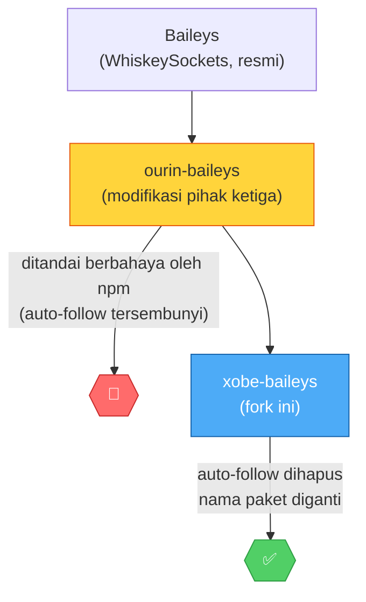

<div align="center">

```
╔══════════════════════════════════════════════════════════════╗
║                                                                ║
║     ██╗  ██╗ ██████╗ ██████╗ ███████╗                        ║
║     ╚██╗██╔╝██╔═══██╗██╔══██╗██╔════╝                        ║
║      ╚███╔╝ ██║   ██║██████╔╝█████╗                          ║
║      ██╔██╗ ██║   ██║██╔══██╗██╔══╝                          ║
║     ██╔╝ ██╗╚██████╔╝██████╔╝███████╗                        ║
║     ╚═╝  ╚═╝ ╚═════╝ ╚═════╝ ╚══════╝                        ║
║                                                                ║
║              B  A  I  L  E  Y  S                              ║
║                                                                ║
╚══════════════════════════════════════════════════════════════╝
```

# ⚡ xobe-baileys

### Pustaka WhatsApp (Baileys v7) untuk pengembangan bot — fork dari `ourin-baileys` dengan auto-follow channel tersembunyi dihapus total.


| 🧩 Interactive Message | 👥 Grup & Admin | 📊 Poll & Event | 🛡️ Session Guard | 🚦 Rate Limit | 🎮 Command Router | 🪪 Dedupe Pesan |
|:---:|:---:|:---:|:---:|:---:|:---:|:---:|
| ✅ | ✅ | ✅ | ✅ | ✅ | ✅ | ✅ |

**[Latar Belakang](#1-latar-belakang)** · **[Instalasi](#3-instalasi)** · **[Panduan Dasar](#4-panduan-dasar)** · **[Referensi API](#6-referensi-api)** · **[Fitur Berkelas](#7-fitur-berkelas-via-protobuf)** · **[Keandalan](#8-utilitas-keandalan)** · **[Pemecahan Masalah](#10-pemecahan-masalah)**

</div>

---

> [!IMPORTANT]
> `xobe-baileys` adalah **fork**, bukan paket yang terkena deteksi *malware*. Paket asalnya, `ourin-baileys`, ditandai berbahaya oleh npm karena fitur auto-follow channel tersembunyi. Fork ini membuang fitur tersebut sepenuhnya — lihat [Bagian 1](#1-latar-belakang) dan [cara verifikasi mandiri](#11-keamanan).

---

## Daftar Isi

1. [Latar Belakang](#1-latar-belakang)
2. [Perbandingan dengan ourin-baileys](#2-perbandingan-dengan-ourin-baileys)
3. [Instalasi](#3-instalasi)
4. [Panduan Dasar](#4-panduan-dasar)
5. [Autentikasi](#5-autentikasi)
6. [Referensi API](#6-referensi-api)
   - [6.1 Pesan Teks & Media](#61-pesan-teks--media)
   - [6.2 Tombol Interaktif (Button Message)](#62-tombol-interaktif-button-message)
   - [6.3 Manajemen Grup](#63-manajemen-grup)
   - [6.4 Status (Presence) & Profil](#64-status-presence--profil)
   - [6.5 Channel (Newsletter)](#65-channel-newsletter)
7. [Fitur Berkelas via Protobuf](#7-fitur-berkelas-via-protobuf)
   - [7.1 Poll Message](#71-poll-message)
   - [7.2 Event Message](#72-event-message)
8. [Utilitas Keandalan](#8-utilitas-keandalan)
   - [8.1 Cache Metadata Grup](#81-cache-metadata-grup)
   - [8.2 Resolusi JID vs LID](#82-resolusi-jid-vs-lid)
   - [8.3 Antrean Pesan (Rate Limiting)](#83-antrean-pesan-rate-limiting)
   - [8.4 Auto-Clear Session yang Korup](#84-auto-clear-session-yang-korup)
   - [8.5 Reconnect dengan Backoff](#85-reconnect-dengan-backoff)
   - [8.6 Logger](#86-logger)
   - [8.7 Graceful Shutdown](#87-graceful-shutdown)
   - [8.8 Command Router](#88-command-router)
   - [8.9 Dedupe Pesan (Anti Duplikat)](#89-dedupe-pesan-anti-duplikat)
9. [Migrasi dari ourin-baileys](#9-migrasi-dari-ourin-baileys)
10. [Pemecahan Masalah](#10-pemecahan-masalah)
11. [Keamanan](#11-keamanan)
12. [Lisensi & Atribusi](#12-lisensi--atribusi)

---

## 1. Latar Belakang

`ourin-baileys`, paket yang menjadi basis fork ini, ditandai sebagai paket berbahaya oleh npm karena mengandung kode tersembunyi yang membuat bot secara otomatis mengikuti (follow) channel WhatsApp tertentu tanpa persetujuan pengguna. `xobe-baileys` adalah fork dari kode fungsional ourin-baileys dengan bagian auto-follow tersebut dihapus sepenuhnya.



Dokumentasi teknis mengenai bagian kode yang dihapus, serta cakupan audit yang sudah dan belum dilakukan, tersedia di [`NOTICE.md`](./NOTICE.md), [`SECURITY.md`](./SECURITY.md), dan [`CHANGELOG.md`](./CHANGELOG.md). Pengguna dianjurkan untuk memverifikasi klaim ini secara independen; lihat [Bagian 11](#11-keamanan).

## 2. Perbandingan dengan ourin-baileys

| Aspek | `ourin-baileys` 9.0.21 | `xobe-baileys` |
|---|---|---|
| Auto-follow channel saat koneksi terbuka | Ada, aktif secara default | Dihapus |
| JID channel yang di-hardcode dalam kode | Ada | Dihapus |
| File source map (`.map`) | Ada | Dihapus |
| Status di registry npm | Ditandai berbahaya | Tidak dipublikasikan ke npm, hanya tersedia via GitHub |
| Fitur inti (interactive message, album, VoIP, dsb.) | Tersedia | Tersedia, tidak diubah |
| Utilitas tambahan (cache grup, resolusi LID, rate limit, dsb.) | Tidak tersedia | Tersedia sejak v1.0.0–1.1.1 |

## 3. Instalasi

### 3.1 Persyaratan

| Komponen | Keterangan |
|---|---|
| Node.js 20 atau lebih baru | Periksa dengan `node -v` |
| Git | Diperlukan karena instalasi dilakukan langsung dari GitHub |
| `"type": "module"` pada `package.json` | Pustaka ini bersifat ESM-only ([lihat alternatif untuk CommonJS](#kalau-project-lu-commonjs)) |

### 3.2 Perintah instalasi

Karena tidak dipublikasikan ke npm, instalasi dilakukan langsung dari repositori GitHub:

```bash
npm install github:gagadeb11116677/xobe-baileys
```

Atau dideklarasikan secara manual pada `package.json`:

```json
{
  "type": "module",
  "dependencies": {
    "xobe-baileys": "github:gagadeb11116677/xobe-baileys"
  }
}
```

### 3.3 Dependensi opsional

| Paket | Fungsi |
|---|---|
| `pino` | Logger (sudah menjadi dependensi internal, tapi disarankan diinstal eksplisit jika dikustomisasi) |
| `qrcode-terminal` | Menampilkan QR login di terminal |
| `sharp` atau `jimp` | Pembuatan thumbnail gambar |
| `link-preview-js` | Pratinjau tautan otomatis |
| `audio-decode` | Pemrosesan audio |
| `ffmpeg` (binari sistem) | Thumbnail video, konversi media |

```bash
npm install pino qrcode-terminal sharp link-preview-js audio-decode
```

---

## 4. Panduan Dasar

Langkah berikut membangun bot WhatsApp minimal dari awal.

**Langkah 1 — Inisialisasi proyek**

```bash
mkdir bot-saya && cd bot-saya
npm init -y
```

**Langkah 2 — Aktifkan mode ESM** pada `package.json`:

```json
{
  "name": "bot-saya",
  "type": "module"
}
```

**Langkah 3 — Instal dependensi**

```bash
npm install github:gagadeb11116677/xobe-baileys pino qrcode-terminal
```

**Langkah 4 — Buat `index.js`**

```js
import makeWASocket, {
  useMultiFileAuthState,
  DisconnectReason,
  Browsers,
} from "xobe-baileys";
import pino from "pino";
import qrcode from "qrcode-terminal";

const logger = pino({ level: "silent" });

async function startBot() {
  const { state, saveCreds } = await useMultiFileAuthState("./session");

  const sock = makeWASocket({
    auth: state,
    logger,
    browser: Browsers.ubuntu("Chrome"),
    syncFullHistory: false,
  });

  sock.ev.on("creds.update", saveCreds);

  sock.ev.on("connection.update", ({ connection, lastDisconnect, qr }) => {
    if (qr) qrcode.generate(qr, { small: true });
    if (connection === "open") console.log("Terhubung.");
    if (connection === "close") {
      const code = lastDisconnect?.error?.output?.statusCode;
      if (code !== DisconnectReason.loggedOut) startBot();
      else console.log("Sesi keluar (logout). Hapus folder session dan login ulang.");
    }
  });

  sock.ev.on("messages.upsert", async ({ messages }) => {
    const msg = messages[0];
    if (!msg?.message || msg.key.fromMe) return;
    const text = msg.message.conversation || msg.message.extendedTextMessage?.text || "";
    if (text === ".ping") {
      await sock.sendMessage(msg.key.remoteJid, { text: "Pong." });
    }
  });
}

startBot();
```

**Langkah 5 — Jalankan**

```bash
node index.js
```

Pindai kode QR yang tampil di terminal melalui WhatsApp (**Perangkat Tertaut → Tautkan Perangkat**). Setelah status `Terhubung.` muncul, kirim `.ping` ke nomor tersebut untuk menguji.

> Folder `session` berisi kredensial login bot. Jangan dibagikan kepada pihak lain dan jangan diunggah ke repositori publik (sudah tercakup dalam `.gitignore`).

---

## 5. Autentikasi

### 5.1 Login dengan kode QR

Ditunjukkan pada [Bagian 4](#4-panduan-dasar) di atas.

### 5.2 Login dengan kode pairing

Alternatif tanpa pemindaian QR, menggunakan kode delapan karakter:

```js
const sock = makeWASocket({
  auth: state,
  logger,
  browser: Browsers.windows("Chrome"),
});

sock.ev.on("connection.update", async ({ connection }) => {
  if (connection === "connecting" && !sock.authState.creds.registered) {
    const code = await sock.requestPairingCode("6281234567890"); // nomor bot, tanpa tanda + dan tanpa spasi
    console.log("Kode pairing:", code);
  }
});
```

Pada WhatsApp: **Perangkat Tertaut → Tautkan Perangkat → Tautkan dengan nomor telepon**, lalu masukkan kode tersebut. Contoh lengkap tersedia pada [`examples/pairing-code.js`](./examples/pairing-code.js).

---

## 6. Referensi API

Seluruh fungsi berikut dipanggil melalui objek `sock` hasil `makeWASocket()`. Variabel `jid` merujuk pada `msg.key.remoteJid` (untuk pesan masuk) atau JID tujuan yang dibentuk melalui `toJid()` (lihat [8.2](#82-resolusi-jid-vs-lid)).

### 6.1 Pesan Teks & Media

```js
// Teks
await sock.sendMessage(jid, { text: "Pesan teks." });

// Gambar
await sock.sendMessage(jid, { image: { url: "./gambar.jpg" }, caption: "Keterangan." });

// Video
await sock.sendMessage(jid, { video: { url: "./video.mp4" }, caption: "Keterangan." });

// Dokumen
await sock.sendMessage(jid, { document: { url: "./berkas.pdf" }, mimetype: "application/pdf", fileName: "berkas.pdf" });

// Album (beberapa media sekaligus)
await sock.sendMessage(jid, {
  albumMessage: [
    { image: { url: "./foto1.jpg" }, caption: "Foto 1" },
    { image: { url: "./foto2.jpg" }, caption: "Foto 2" },
  ],
});

// Membalas pesan
await sock.sendMessage(jid, { text: "Balasan." }, { quoted: msg });
```

### 6.2 Tombol Interaktif (Button Message)

Tombol pada WhatsApp modern dikirim melalui `interactiveMessage`. Setiap elemen `buttons` memiliki `name` yang menentukan jenis tombol.

**Quick reply, tautan, dan salin kode dalam satu pesan:**

```js
await sock.sendMessage(jid, {
  interactiveMessage: {
    title: "Judul Pesan",
    footer: "xobe-baileys",
    header: "Pilih salah satu opsi berikut",
    buttons: [
      {
        name: "quick_reply",
        buttonParamsJson: JSON.stringify({ display_text: "Menu", id: ".menu" }),
      },
      {
        name: "cta_url",
        buttonParamsJson: JSON.stringify({ display_text: "Buka Situs", url: "https://example.com" }),
      },
      {
        name: "cta_copy",
        buttonParamsJson: JSON.stringify({ display_text: "Salin Kode", copy_code: "KODE123" }),
      },
    ],
  },
});
```

**Menu daftar (list/single_select):**

```js
await sock.sendMessage(jid, {
  interactiveMessage: {
    title: "Pilih Kategori",
    footer: "xobe-baileys",
    header: "Menu Bot",
    buttons: [{
      name: "single_select",
      buttonParamsJson: JSON.stringify({
        title: "Buka Menu",
        sections: [{
          title: "Peralatan",
          rows: [
            { title: "Stiker", id: ".sticker" },
            { title: "Teks ke Suara", id: ".tts" },
          ],
        }],
      }),
    }],
  },
});
```

**Dengan gambar header:** tambahkan properti `image: { url: "..." }` pada level `interactiveMessage`, sejajar dengan `title`.

**Menangani balasan tombol**, pada handler `messages.upsert`:

```js
sock.ev.on("messages.upsert", async ({ messages }) => {
  const msg = messages[0];
  const buttonId =
    msg.message?.interactiveResponseMessage?.nativeFlowResponseMessage?.paramsJson;
  if (buttonId) {
    const { id } = JSON.parse(buttonId);
    // id berisi nilai yang didefinisikan pada properti "id" tombol terkait
  }
});
```

### 6.3 Manajemen Grup

| Fungsi | Deskripsi | Contoh |
|---|---|---|
| `groupCreate(subject, participants)` | Membuat grup baru | `await sock.groupCreate("Nama Grup", ["628xxx@s.whatsapp.net"])` |
| `groupMetadata(jid)` | Mengambil metadata grup (nama, anggota, admin, dsb.) | `const meta = await sock.groupMetadata(groupJid)` |
| `groupUpdateSubject(jid, subject)` | Mengubah nama grup | `await sock.groupUpdateSubject(groupJid, "Nama Baru")` |
| `groupParticipantsUpdate(jid, participants, action)` | Menambah/mengeluarkan/mempromosikan anggota. `action`: `"add"`, `"remove"`, `"promote"`, `"demote"` | `await sock.groupParticipantsUpdate(groupJid, [userJid], "add")` |
| `groupSettingUpdate(jid, setting)` | Mengubah pengaturan grup. `setting`: `"announcement"` (hanya admin yang dapat mengirim), `"not_announcement"`, `"locked"` (hanya admin yang dapat mengubah info), `"unlocked"` | `await sock.groupSettingUpdate(groupJid, "announcement")` |
| `groupInviteCode(jid)` | Mengambil kode undangan grup | `const code = await sock.groupInviteCode(groupJid)` |
| `groupLeave(jid)` | Keluar dari grup | `await sock.groupLeave(groupJid)` |
| `groupFetchAllParticipating()` | Mengambil seluruh grup yang diikuti bot | `const groups = await sock.groupFetchAllParticipating()` |

**Contoh — menyebut (mention) seluruh anggota grup:**

```js
const metadata = await sock.groupMetadata(groupJid);
const participants = metadata.participants.map((p) => p.id);

await sock.sendMessage(groupJid, {
  text: participants.map((p) => `@${p.split("@")[0]}`).join(" "),
  mentions: participants,
});
```

> Pada beberapa kasus, `participants.map((p) => p.id)` dapat mengembalikan JID dalam format LID (`@lid`), bukan format nomor telepon standar (`@s.whatsapp.net`), yang menyebabkan mention tidak mengarah ke kontak yang benar. Lihat [8.2](#82-resolusi-jid-vs-lid) untuk solusinya.

### 6.4 Status (Presence) & Profil

| Fungsi | Deskripsi |
|---|---|
| `sendPresenceUpdate(type, jid?)` | Mengubah status kehadiran. `type`: `"available"`, `"unavailable"`, `"composing"` (mengetik), `"recording"` (merekam suara), `"paused"` |
| `updateProfileStatus(status)` | Mengubah teks status profil (bio) akun bot |
| `fetchStatus(jid)` | Mengambil teks status profil kontak lain |

```js
// Menampilkan indikator "sedang mengetik" selama beberapa detik
await sock.sendPresenceUpdate("composing", jid);
await new Promise((r) => setTimeout(r, 2000));
await sock.sendPresenceUpdate("paused", jid);

// Mengubah status profil bot
await sock.updateProfileStatus("Bot aktif 24 jam.");
```

### 6.5 Channel (Newsletter)

Fungsi ini **hanya** dijalankan apabila dipanggil secara eksplisit oleh kode bot; tidak ada mekanisme otomatis di dalam xobe-baileys yang memanggilnya tanpa instruksi.

```js
const info = await sock.cekIDSaluran("https://whatsapp.com/channel/xxxxx");
console.log(info.name, info.subscribers);

await sock.newsletterFollow("1203630000000000@newsletter");
await sock.newsletterUnfollow("1203630000000000@newsletter");
```

Daftar fungsi lain di luar cakupan dokumen ini (komunitas, VoIP, rich response, dsb.) tersedia pada [`docs/README-ourin-original.md`](./docs/README-ourin-original.md), dengan catatan dokumen tersebut masih menyebut nama paket `ourin-baileys` pada contoh importnya.

---

## 7. Fitur Berkelas via Protobuf

> *Setiap pesan WhatsApp — teks, gambar, tombol, polling — pada akhirnya adalah satu objek `proto.Message` yang sama, didefinisikan dalam berkas `.proto` resmi WhatsApp Web (`WAProto/WAProto.proto`). Dua fitur berikut tidak dibangun dari API tingkat tinggi yang disederhanakan, melainkan memetakan langsung ke field protobuf-nya: `pollCreationMessage` dan `eventMessage`. Fungsinya sudah ada sejak basis ourin-baileys, namun belum pernah didokumentasikan sebelum revisi ini.*

### 7.1 Poll Message

Poll (jajak pendapat) dipetakan ke field `Message.PollCreationMessage` pada protobuf. Opsi `toAnnouncementGroup` menentukan apakah pesan dibangun sebagai `pollCreationMessageV2` (varian untuk grup pengumuman/komunitas) atau varian standar.

```js
await sock.sendMessage(jid, {
  poll: {
    name: "Jadwal rilis versi berikutnya?",
    values: ["Minggu ini", "Minggu depan", "Belum ditentukan"],
    selectableCount: 1,          // 0 = boleh pilih lebih dari satu opsi
    toAnnouncementGroup: false,  // true untuk grup pengumuman/komunitas
  },
});
```

| Properti | Tipe | Keterangan |
|---|---|---|
| `name` | `string` | Pertanyaan/judul polling |
| `values` | `string[]` | Daftar opsi jawaban |
| `selectableCount` | `number` | Jumlah opsi yang boleh dipilih (`0` = bebas) |
| `messageSecret` | `Uint8Array` | Kunci 32 byte untuk enkripsi hasil polling; dibuat otomatis jika tidak diisi |
| `toAnnouncementGroup` | `boolean` | Gunakan varian V2 untuk grup pengumuman/komunitas |

**Membaca hasil polling** dilakukan melalui event `messages.update`, karena WhatsApp mengirim update terenkripsi setiap kali seseorang memilih opsi:

```js
sock.ev.on("messages.update", (updates) => {
  for (const { update } of updates) {
    if (update.pollUpdates) {
      // vote baru masuk; dekripsi memerlukan messageSecret dari pesan poll asal —
      // lihat fungsi getAggregateVotesInPollMessage pada dokumentasi ourin-baileys asli
      // (docs/README-ourin-original.md) untuk contoh agregasi lengkap.
    }
  }
});
```

### 7.2 Event Message

Event message dipetakan ke field `Message.EventMessage` — fitur "acara"/kalender WhatsApp, lengkap dengan opsi tautan panggilan suara/video terjadwal.

```js
await sock.sendMessage(jid, {
  event: {
    name: "Rapat Rilis xobe-baileys",
    description: "Pembahasan fitur untuk rilis berikutnya.",
    startDate: new Date("2026-11-10T19:00:00+07:00"),
    endDate: new Date("2026-11-10T20:00:00+07:00"),
    call: "video",             // "audio" | "video" | tidak diisi (tanpa tautan panggilan)
    extraGuestsAllowed: true,
    isScheduleCall: true,
  },
});
```

| Properti | Tipe | Keterangan |
|---|---|---|
| `name` | `string` | Nama acara |
| `description` | `string` | Deskripsi acara (opsional) |
| `startDate` | `Date` | Wajib diisi |
| `endDate` | `Date` | Opsional |
| `location` | `WALocationMessage` | Lokasi fisik acara (opsional) |
| `call` | `"audio" \| "video"` | Menyertakan tautan panggilan terjadwal |
| `isCancelled` | `boolean` | Menandai acara sebagai dibatalkan |
| `extraGuestsAllowed` | `boolean` | Mengizinkan tamu tambahan |
| `isScheduleCall` | `boolean` | Menandai sebagai panggilan terjadwal |

> Membangun tautan panggilan (`call`) memerlukan opsi `getCallLink` tambahan pada pemanggilan `sendMessage` di sebagian konfigurasi server WhatsApp. Jika tautan panggilan tidak muncul, acara tetap terkirim tanpa tautan tersebut — bukan kegagalan pengiriman.

---

## 8. Utilitas Keandalan

Bagian ini mendokumentasikan fungsi tambahan yang tidak tersedia pada ourin-baileys maupun Baileys resmi, ditambahkan khusus pada fork ini.

### 8.1 Cache Metadata Grup

Setiap pengiriman pesan ke grup secara default memicu permintaan `groupMetadata` ke server WhatsApp (diperlukan untuk enkripsi ke seluruh anggota). Pada bot dengan volume pengiriman tinggi ke grup yang sama, hal ini menjadi permintaan yang berulang secara tidak perlu.

```js
import makeWASocket, { useMultiFileAuthState, makeCachedGroupMetadata } from "xobe-baileys";

const { state, saveCreds } = await useMultiFileAuthState("./session");
const groupCache = makeCachedGroupMetadata({ ttlMs: 5 * 60 * 1000 });

const sock = makeWASocket({ auth: state, cachedGroupMetadata: groupCache.get });
sock.ev.on("creds.update", saveCreds);
groupCache.attach(sock); // cache otomatis + invalidasi otomatis saat grup berubah
```

Referensi: [`examples/group-metadata-cache.js`](./examples/group-metadata-cache.js).

### 8.2 Resolusi JID vs LID

WhatsApp dapat mengembalikan identitas pengguna dalam format LID (`12345@lid`, identitas internal) alih-alih JID nomor telepon (`628xxx@s.whatsapp.net`). Penggunaan LID secara langsung pada parameter `mentions` menyebabkan penyebutan (tag) mengarah ke identitas yang tidak sesuai dengan kontak sebenarnya.

```js
import { resolvePNJid, resolvePNJids, toJid } from "xobe-baileys";

const resolved = await resolvePNJids(sock, participantJids);
await sock.sendMessage(groupJid, {
  text: resolved.map((j) => `@${j.split("@")[0]}`).join(" "),
  mentions: resolved,
});

toJid("0812-3456-7890"); // → "081234567890@s.whatsapp.net"
```

`resolvePNJid` menggunakan `signalRepository.lidMapping` bawaan pustaka, yang terisi otomatis seiring pesan diterima. Apabila pemetaan untuk suatu LID belum tersedia, fungsi mengembalikan nilai LID tersebut tanpa modifikasi (tidak menimbulkan kegagalan).

### 8.3 Antrean Pesan (Rate Limiting)

Pengiriman pesan beruntun tanpa jeda ke banyak kontak/grup merupakan pola yang terdeteksi WhatsApp sebagai aktivitas spam dan merupakan penyebab umum pemblokiran akun. `makeMessageQueue` menyediakan antrean dengan jeda minimum dan batas jumlah pengiriman per menit.

```js
import { makeMessageQueue } from "xobe-baileys";

const queue = makeMessageQueue(sock, { delayMs: 1500, maxPerMinute: 20 });
await queue.sendMessage(jid, { text: "Pesan." }); // dipanggil setara dengan sock.sendMessage
```

### 8.4 Auto-Clear Session yang Korup

**Gejala.** Log berulang berbunyi `MessageCounterError: Key used already or never filled`, `Bad MAC`, atau `No matching sessions found` untuk kontak yang sama. Ini merupakan indikasi session enkripsi (protokol Signal) dengan kontak tersebut tidak lagi sinkron.

**Penyebab umum.** Dua instance bot berjalan bersamaan dengan folder session yang sama, atau proses pada platform hosting yang berhenti secara tidak normal (restart paksa) sehingga state di memori dan di berkas session tidak lagi konsisten. Kesalahan jenis ini bersumber dari dependensi `libsignal` (implementasi protokol Signal pihak ketiga), bukan dari kode xobe-baileys itu sendiri, dan juga ditemukan pada ourin-baileys maupun Baileys resmi dalam kondisi yang sama.

**Solusi yang disediakan.** `attachSessionGuard` memantau log kegagalan dekripsi. Apabila kegagalan yang sama terjadi berulang untuk kontak tertentu dalam rentang waktu yang ditentukan, fungsi ini menghapus **hanya** kunci session untuk kontak tersebut — bukan seluruh folder session — sehingga protokol Signal akan membangun ulang session tersebut secara otomatis pada pesan berikutnya tanpa memerlukan login ulang (QR/pairing).

```js
import makeWASocket, { attachSessionGuard } from "xobe-baileys";

const sock = makeWASocket({ auth: state });

attachSessionGuard(sock, {
  threshold: 3,        // jumlah kegagalan beruntun sebelum session dihapus
  windowMs: 120_000,   // rentang waktu yang diperhitungkan (milidetik)
  onClear: (jid) => console.log(`Session untuk ${jid} telah di-reset otomatis.`),
});
```

Referensi: [`examples/session-guard.js`](./examples/session-guard.js). Penghapusan dapat dipicu secara manual melalui `const guard = attachSessionGuard(sock); await guard.clearNow(jid)`.

> Apabila kegagalan terjadi untuk hampir seluruh kontak secara bersamaan (bukan satu kontak tertentu), kemungkinan penyebabnya adalah dua instance bot berjalan bersamaan menggunakan folder session yang sama. Pastikan hanya satu proses yang berjalan per session sebelum mengandalkan fitur ini.

### 8.5 Reconnect dengan Backoff

Pola reconnect naif (memanggil ulang fungsi start tanpa jeda) dapat menimbulkan perulangan koneksi yang sangat cepat ketika WhatsApp mengalami gangguan. `withReconnect` menambahkan jeda yang meningkat secara eksponensial pada setiap kegagalan berturut-turut.

```js
import { withReconnect, DisconnectReason } from "xobe-baileys";

const reconnect = withReconnect(startBot, { baseMs: 2000, maxMs: 60_000 });

sock.ev.on("connection.update", ({ connection, lastDisconnect }) => {
  if (connection === "open") reconnect.reset();
  if (connection === "close") {
    const code = lastDisconnect?.error?.output?.statusCode;
    if (code !== DisconnectReason.loggedOut) reconnect.schedule();
  }
});
```

### 8.6 Logger

```js
import { createLogger } from "xobe-baileys";
const logger = createLogger({ level: "warn" }); // nilai default: "silent"
const sock = makeWASocket({ auth: state, logger });
```

### 8.7 Graceful Shutdown

Melengkapi [8.4](#84-auto-clear-session-yang-korup): jika 8.4 menangani session yang **sudah** korup, bagian ini mencegah korupsi terjadi di titik awal. Penyebab paling umum session korup adalah proses bot yang dihentikan secara paksa (`SIGTERM` dari platform hosting saat restart/redeploy, atau `Ctrl+C`) di tengah proses penulisan berkas session.

`attachGracefulShutdown` menangkap sinyal `SIGINT`/`SIGTERM`, memastikan `saveCreds()` selesai dijalankan, menutup koneksi socket dengan bersih (`sock.end()`), baru kemudian proses keluar.

```js
import makeWASocket, { useMultiFileAuthState, attachGracefulShutdown } from "xobe-baileys";

const { state, saveCreds } = await useMultiFileAuthState("./session");
const sock = makeWASocket({ auth: state });
sock.ev.on("creds.update", saveCreds);

attachGracefulShutdown(sock, {
  saveCreds,
  onShutdown: (signal) => console.log(`Menerima ${signal}, menyimpan session sebelum keluar...`),
});
```

> [!NOTE]
> `SIGKILL` (`kill -9`) tidak dapat ditangkap oleh proses Node.js manapun — ini batasan sistem operasi, bukan batasan pustaka ini. Fitur ini menangani kasus restart/redeploy yang normal (`SIGTERM`/`SIGINT`), bukan seluruh kemungkinan penghentian paksa.

Referensi: [`examples/graceful-shutdown.js`](./examples/graceful-shutdown.js).

### 8.8 Command Router

Setiap bot berbasis prefix (`.ping`, `!menu`, dsb.) pada akhirnya menulis ulang logika yang sama: parsing prefix, mencocokkan nama command, memeriksa apakah pengirim adalah owner, dan menangkap error supaya satu command yang gagal tidak menjatuhkan seluruh proses bot. `makeCommandRouter` membungkus pola ini.

```js
import makeWASocket, { useMultiFileAuthState, makeCommandRouter } from "xobe-baileys";

const { state, saveCreds } = await useMultiFileAuthState("./session");
const sock = makeWASocket({ auth: state });
sock.ev.on("creds.update", saveCreds);

const router = makeCommandRouter({
  prefix: ".",
  ownerJids: ["628xxxxxxxxxx@s.whatsapp.net"],
  commands: {
    ping: {
      handler: async ({ sock, jid }) => sock.sendMessage(jid, { text: "Pong." }),
    },
    menu: {
      aliases: ["help"],
      handler: async ({ sock, jid }) => sock.sendMessage(jid, { text: `Command: ${router.list().join(", ")}` }),
    },
    restart: {
      ownerOnly: true,
      handler: async ({ sock, jid }) => sock.sendMessage(jid, { text: "Restart diminta." }),
    },
  },
  onUnauthorized: async ({ sock, jid }) => sock.sendMessage(jid, { text: "Command ini khusus owner." }),
});

sock.ev.on("messages.upsert", async ({ messages }) => {
  const msg = messages[0];
  if (!msg?.message || msg.key.fromMe) return;
  await router.handle(sock, msg); // return true kalau pesan cocok sebuah command
});
```

| Opsi | Keterangan |
|---|---|
| `prefix` | Awalan command, default `"."` |
| `commands` | Peta nama command → `{ handler, aliases?, ownerOnly? }` |
| `ownerJids` | Daftar JID yang dianggap owner (dicek saat `ownerOnly: true`) |
| `onUnauthorized` | Dipanggil kalau non-owner mencoba command `ownerOnly` |
| `onError` | Dipanggil kalau `handler` sebuah command melempar error; default-nya dicatat lewat `sock.logger.error` |

> [!NOTE]
> Teks command diambil dari `conversation` dan `extendedTextMessage.text`. Jika bot juga perlu membaca command dari caption gambar/video, tambahkan ekstraksi teks tersebut sebelum memanggil `router.handle`.

Referensi: [`examples/command-router.js`](./examples/command-router.js).

### 8.9 Dedupe Pesan (Anti Duplikat)

WhatsApp dapat mengirim ulang pesan yang sama lewat event `messages.upsert` — paling sering terjadi saat bot baru selesai *reconnect* setelah koneksi sempat terputus. Tanpa penanganan, ini membuat bot membalas pesan yang sama dua kali atau lebih, yang dari sisi pengguna terlihat seperti bug acak.

```js
import { makeMessageDedupe } from "xobe-baileys";

const dedupe = makeMessageDedupe({ ttlMs: 10 * 60_000 }); // lacak 10 menit terakhir

sock.ev.on("messages.upsert", dedupe.wrapHandler(async ({ messages }) => {
  // "messages" di sini sudah difilter, tidak ada id yang sama dua kali
  const msg = messages[0];
  // ...proses seperti biasa
}));
```

| Opsi | Keterangan |
|---|---|
| `max` | Jumlah maksimum id pesan yang dilacak sekaligus (default `1000`) |
| `ttlMs` | Berapa lama id pesan diingat sebelum dianggap kedaluwarsa (default 10 menit) |

> [!NOTE]
> Ini mengatasi **satu kelas bug spesifik** (pesan terduplikasi akibat redelivery dari WhatsApp), bukan solusi umum untuk "semua error". Penyebab error lain pada bot — kesalahan logika command, dependensi yang hilang, dsb. — tetap perlu ditangani masing-masing sesuai kasusnya.

Referensi: [`examples/message-dedupe.js`](./examples/message-dedupe.js).

---

## 9. Migrasi dari ourin-baileys

```bash
npm uninstall ourin-baileys
npm install github:gagadeb11116677/xobe-baileys
rm -rf node_modules package-lock.json
npm install
```

Periksa seluruh referensi `ourin-baileys` dalam kode sumber:

```bash
grep -rn "ourin-baileys" --include=*.js --include=*.mjs --include=*.cjs .
```

```powershell
Get-ChildItem -Recurse -Include *.js,*.mjs,*.cjs -Exclude node_modules | Select-String "ourin-baileys"
```

Disarankan melakukan pengujian pada nomor cadangan sebelum diterapkan pada nomor produksi.

---

## 10. Pemecahan Masalah

<details>
<summary><code>MessageCounterError</code> / <code>Bad MAC</code> / <code>No matching sessions found</code> berulang</summary>

Lihat [Bagian 8.4](#84-auto-clear-session-yang-korup). Penyebab paling umum: dua instance bot berjalan bersamaan dengan session yang sama.

</details>

<details>
<summary id="kalau-project-lu-commonjs"><code>Cannot use import statement outside a module</code> / <code>ERR_REQUIRE_ESM</code></summary>

Pustaka ini bersifat **ESM-only**. Jika proyek masih `"type": "commonjs"` (atau tidak mendeklarasikan `type` sama sekali) dan menggunakan `require`, maka `require("xobe-baileys")` akan gagal. Dua solusi:

**Opsi A — import dinamis** (tanpa mengubah proyek menjadi ESM):

```js
async function start() {
  const baileys = await import("xobe-baileys");
  const makeWASocket = baileys.default;
  const { useMultiFileAuthState, DisconnectReason } = baileys;

  const { state, saveCreds } = await useMultiFileAuthState("./session");
  const sock = makeWASocket({ auth: state });
  // ...lanjutkan seperti biasa
}
start();
```

**Opsi B — jadikan proyek ESM sepenuhnya**: tambahkan `"type": "module"` pada `package.json`, ganti seluruh `require` menjadi `import`, dan sesuaikan penggunaan `__dirname`/`__filename` jika ada.

</details>

<details>
<summary>Kode QR tidak muncul</summary>

Properti `printQRInTerminal` telah usang (deprecated). Tangkap nilai `qr` dari event `connection.update` dan tampilkan menggunakan `qrcode-terminal` sebagaimana contoh pada Bagian 4.

</details>

<details>
<summary>Koneksi terputus-sambung berulang (loop)</summary>

Umumnya disebabkan oleh berkas session yang rusak. Hentikan proses, hapus folder `session`, lalu lakukan login ulang. Pertimbangkan pula penggunaan [`withReconnect`](#85-reconnect-dengan-backoff) agar percobaan ulang tidak terjadi tanpa jeda.

</details>

<details>
<summary>Thumbnail atau stiker tidak terbentuk</summary>

Instal `sharp` (atau `jimp`), serta `ffmpeg` untuk pemrosesan video.

</details>

<details>
<summary>Fitur panggilan suara (VoIP) tidak berfungsi</summary>

Memerlukan paket tambahan `@roamhq/wrtc` dan `ffmpeg` terpasang pada sistem.

</details>

<details>
<summary><code>npm install</code> dari GitHub gagal</summary>

Pastikan Git terpasang (`git --version`) dan repositori bersifat publik.

</details>

---

## 11. Keamanan

> [!CAUTION]
> Jangan percaya klaim "sudah diaudit" dari README manapun tanpa verifikasi mandiri — termasuk README ini. Perintah verifikasi ada di akhir bagian ini.

| Komponen | Status audit | Terakhir diperiksa |
|---|:---:|---|
| Fitur auto-follow channel | ✅ Dihapus & diverifikasi | v1.0.0 |
| `lib/WAM/constants.js` | ✅ Diaudit (data statis, tanpa kode eksekusi) | v1.1.2 |
| `lib/assets/wasm/*` | ✅ Diaudit (hasil build Emscripten resmi) | v1.1.2 |
| `lib/Signal/*` (enkripsi) | ⚪ Tidak pernah diubah dari basis ourin-baileys | — |
| Seluruh file `.js` lib/WAProto/examples | ✅ Lolos `node --check` tiap rilis | setiap rilis (CI) |

- Paket `ourin-baileys` asli telah ditandai sebagai berbahaya oleh npm (Oktober 2026). Fork ini telah dibersihkan dari fitur auto-follow channel, namun **belum seluruh berkas diaudit secara menyeluruh**. Status audit lengkap, termasuk berkas mana yang sudah dan belum diperiksa, didokumentasikan pada [`SECURITY.md`](./SECURITY.md).
- Pengguna yang sebelumnya menggunakan `ourin-baileys` asli disarankan memperlakukan perangkat tersebut sebagai berpotensi disusupi: lakukan rotasi token/API key dan pasangkan ulang (re-pair) akun WhatsApp dari perangkat yang bersih.
- Jangan mengunggah folder `session/`, berkas `creds.json`, atau `.env` ke repositori publik manapun.
- Pustaka ini tidak resmi dan tidak berafiliasi dengan WhatsApp maupun Meta. Penggunaan untuk aktivitas spam atau bulk messaging berisiko mengakibatkan pemblokiran akun.
- Tidak terdapat jaminan (warranty) dalam bentuk apa pun. Penggunaan sepenuhnya menjadi tanggung jawab pengguna.

Cara memverifikasi klaim penghapusan auto-follow secara mandiri:

```bash
grep -rn "autoFollow" lib
grep -rn "120363400911374213" lib
```

Kedua perintah di atas seharusnya tidak menghasilkan keluaran apa pun.

---

## 12. Lisensi & Atribusi

Dilisensikan di bawah **MIT License**. Hak cipta asli tetap menjadi milik pengembang Baileys dan ourin-baileys. Berkas [`LICENSE`](./LICENSE) tidak boleh dihapus pada turunan apa pun dari repositori ini.

**Atribusi:**
- [WhiskeySockets/Baileys](https://github.com/WhiskeySockets/Baileys) — pustaka dasar yang menjadi fondasi seluruh fungsionalitas protokol WhatsApp pada repositori ini.
- `ourin-baileys` — modifikasi pihak ketiga yang menambahkan sejumlah fitur (interactive message, album, VoIP) yang menjadi basis kode fork ini.

<div align="center">

---

### 📦 Ringkasan Rilis 1.1.3

| | |
|---|---|
| Utilitas bawaan | 10 (cache grup, resolusi LID, rate limit, session guard, reconnect, logger, graceful shutdown, command router, **dedupe pesan**) |
| Fitur protobuf terdokumentasi | 2 (Poll, Event) |
| Status auto-follow | Dihapus & dapat diverifikasi (`grep -rn "autoFollow" lib`) |
| Lisensi | MIT |

**xobe-baileys** — dibangun di atas kerja [WhiskeySockets/Baileys](https://github.com/WhiskeySockets/Baileys) · fork dari `ourin-baileys`

</div>
